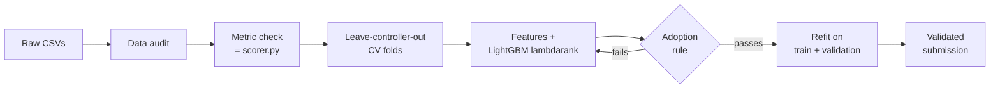

<div align="center">

# ✈️ AWARE · Which task is the controller working on?

**Engage 2 Hackathon · Zagreb · 20–21 October 2026**

Ranking the open tasks of an en-route air traffic controller to predict the one they are handling right now.


</div>

---

## 🏆 Results

Every score is the **top-3 hit rate**: a sample counts as correct when the true task is among our three guesses.
"CV" is leave-controller-out cross-validation, so it measures performance on controllers the model has never seen.

| Model | CV | Validation |
|---|---:|---:|
| Random guess | 0.091 | 0.097 |
| Organisers' rule baseline | 0.356 | 0.485 |
| LightGBM, binary classifier | 0.650 | 0.652 |
| LightGBM lambdarank, run-length weighting, causal features only | 0.661 | 0.661 |
| + block features from later snapshots | 0.901 | 0.929 |
| **+ aircraft state changes around the block, two-model blend (final)** | **0.906** | **0.930** |

The block-feature model scored **0.94 on the public leaderboard**. It also gets the true task as the first guess 79% of the time.

## 🎯 The challenge

The [AWARE](aware_task_prediction_organized.md) research system watches radar, flight-plan and coordination data and keeps an automatic list of a controller's open tasks. It rewrites the list every 3 seconds. A typical list looks like this:

| Task | Meaning |
|---|---|
| `assume_aircraft_SAS95T` | accept SAS95T from the previous sector |
| `transfer_aircraft_RYR1977` | hand RYR1977 over to the next sector |
| `zone_conflict_FIN954` | FIN954's route crosses an active military zone |
| `exit_coordination_GFM7Z` | agree with the next sector how GFM7Z will leave |

Experts replayed simulator sessions from the Swedish upper-airspace sector **ESMM_23** and marked which task the controller was working on at each moment. Lists hold between 9 and 59 tasks, about 36 on average. For each snapshot we submit three tasks, best first.

| Split | Sessions | Controllers | Samples | Rows |
|---|---:|---|---:|---:|
| Train | 34 | 16 | 11,923 | 432,578 |
| Validation | 3 | 019, 020 | 1,252 | 42,110 |
| Test | 5 | 020 (public), 023 (private, never seen) | 1,863 | 66,409 |

## 💡 The key insight: tasks vanish when they are done

Labelled snapshots come in **blocks**: runs of consecutive snapshots 3 seconds apart while the controller works on something. Within a block the answer stays the same 95% of the time.

When a controller finishes a task, AWARE removes it from the list. So the task being worked on tends to **disappear right at the end of its block**.

```
time →    10:00:00   10:00:03   10:00:06   10:00:09    ...gap...    10:00:52
          [═══════════════ block ═══════════════]                   [next block
task X     listed     listed     listed     listed                   gone      ← finished!
task Y     listed     listed     listed     listed                   listed
```

The test file contains whole sessions, so for each snapshot we can look at what happens next in the same session. We use only timestamps, task names and controller-input times, never labels.

| Signal on validation | True task | Other tasks |
|---|---:|---:|
| Task is last seen exactly at the end of the block | **49%** | 3% |
| Controller gives an instruction to the aircraft during the block | **39%** | 4% |

These features lifted CV from **0.661 to 0.901**, and the gain held in all four folds.

> [!IMPORTANT]
> The final model reads snapshots that come *after* the moment it predicts. That is allowed in the competition, but it makes this a **transductive, offline model**: in a real control room the future is not available yet. The best strictly causal model in this repo scores **0.661**.

## 🔬 How we worked



- **Trust the data first.** An automatic audit checks counts, one positive per sample, unique tasks and disjoint sessions. The results are in [reports/data_audit.md](reports/data_audit.md).
- **Trust the metric.** A test checks that our internal top-3 metric gives the same score as the official `scorer.py`.
- **Validate on unseen controllers.** Folds group the 16 training controllers four at a time. A random split would leak near-identical snapshots taken 3 seconds apart.
- **Rebuild the baseline exactly.** Our version of the organisers' rule matches all 1,863 test samples of `sample_submission.csv`. That showed task types are ranked by positive rate, not by frequency as the docs say.
- **Learn to rank.** LightGBM with a lambdarank objective scores every task in a snapshot. We sort the scores and keep the top three.
- **Don't count the same moment twice.** Each sample is weighted by 1/√(run length), so long runs of identical snapshots don't dominate training. This beat the unweighted model in 4 of 4 folds.
- **Adopt only stable gains.** Changing only the random seed moves the score by about 0.005. A change is adopted only if it raises mean CV, wins in at least 3 of 4 folds and doesn't lower validation by more than 0.01. Every comparison averages 3 seeds.
- **Log everything.** Every run, including the rejected ones, is in [reports/experiments.csv](reports/experiments.csv).

### The final model

An equal-weight blend of within-sample z-scores from two LightGBM lambdarank models. Each averages 3 seeds and uses the 86 provided features plus the task type.

| Model | Extra features |
|---|---|
| `lr_rw5_lead_3s` | `lead_blk`: block position, task lifetime relative to the block, next controller input |
| `lr_rw5_leadchg_3s` | `lead_blk` + `lead_chg`: aircraft state just before and just after the block |

The blend weights were fixed in advance, so nothing was tuned on validation. Both models were refit on train + validation with iteration counts taken from CV.

### What didn't work

Most "obvious" ideas made the model worse on unseen controllers.

| Idea | Effect on CV |
|---|---|
| Within-snapshot ranks and comparisons | −0.012, worse in 4 of 4 folds |
| Per-aircraft statistics, deltas vs the previous snapshot | −0.002 to −0.009 |
| Smoothing scores over past snapshots | no gain |
| Target encoding of (scenario, task) | −0.005 |
| XGBoost, CatBoost, other LightGBM settings | none beat the base LightGBM |
| Pooling scores over each block | validation −0.006, rejected |

### Where it still misses

Top-3 by true task type for the block-feature model in CV:

| Task type | Top-3 |
|---|---:|
| Transfer | 0.98 |
| Assume | 0.98 |
| Zone conflict | 0.92 |
| Return to route | 0.84 |
| Entry coordination | 0.71 |
| **Exit coordination** | **0.57** |

Coordination tasks often stay in the list after the controller has dealt with them, so the "vanishing task" signal is weaker for them.

## 🚀 Quickstart

**1. Set up the environment** with Python 3.12:

```bash
git clone https://github.com/antoniocariaa/Engage2-Hackathon.git
cd Engage2-Hackathon
python3 -m venv .venv
.venv/bin/pip install -r requirements.txt
```

**2. Add the data.** The competition files are not in the repo. Put `train.csv`, `validation.csv`, `test.csv` and `sample_submission.csv` in the repository root.

**3. Reproduce the final submission.** Run every command from the repository root:

```bash
PY=.venv/bin/python
$PY -m src.validate_data                                  # data audit + Parquet cache
$PY -m tests.test_metric_vs_scorer                        # internal metric == scorer.py
$PY -m src.train baselines                                # random, type prior, organisers' rule
$PY -m src.train cv lr_rw5_lead_3s lr_rw5_leadchg_3s      # CV + validation scores
$PY -m src.blend_fixed lr_rw5_lead_3s lr_rw5_leadchg_3s   # equal-weight blend on CV + validation
$PY -m src.train final lr_rw5_lead_3s                     # refit on train + validation
$PY -m src.train final lr_rw5_leadchg_3s
$PY -m src.predict lr_rw5_lead_3s,lr_rw5_leadchg_3s --out submissions/submission.csv
$PY -m src.validate_submission submissions/submission.csv
```

To score the validation set with the official scorer:

```bash
$PY -m src.predict lr_rw5_lead_3s,lr_rw5_leadchg_3s --val-from-cv
$PY scorer.py --labelled validation.csv submissions/validation_submission.csv
```

The final pipeline runs on CPU. LightGBM is run with `deterministic=true` and seeds 42, 43 and 44. The generated folders `cache/`, `artifacts/`, `logs/` and `submissions/` are ignored by git and are recreated by these commands.

## 📁 Repository layout

```
├── config/default.yaml          paths, seed, folds, LightGBM base parameters
├── scorer.py                    official top-3 scorer
├── src/
│   ├── data_io.py               typed CSV loading, Parquet cache, schema checks
│   ├── validate_data.py         data audit → reports/data_audit.md
│   ├── cv.py                    leave-controller-out folds
│   ├── metrics.py               top-3 hit rate, session-block bootstrap
│   ├── baselines.py             random, type prior, exact organisers' rule
│   ├── features.py              all feature groups, including lead_blk and lead_chg
│   ├── models.py                LightGBM / XGBoost / CatBoost wrappers
│   ├── train.py                 experiment registry, CV runs and final refit
│   ├── rank.py                  within-sample ranking and submission writing
│   ├── blend_fixed.py           pre-specified equal-weight blend
│   ├── ensemble.py              CV-weighted blends
│   ├── compare.py               paired fold and bootstrap comparisons
│   ├── predict.py               artifacts → submission
│   ├── validate_submission.py   strict submission checker
│   └── …                        importance, error analysis, smoothing, block pooling, exit-coordination studies
├── tests/test_metric_vs_scorer.py
└── reports/                     report, experiment log, comparisons, error analysis
```

## 📚 Further reading

| File | What's inside |
|---|---|
| [reports/REPORT.md](reports/REPORT.md) | Full technical report with every experiment and decision |
| [PRESENTAZIONE.md](PRESENTAZIONE.md) | Non-technical walkthrough of the project, in Italian |
| [aware_task_prediction_organized.md](aware_task_prediction_organized.md) | Challenge description and column dictionary |
| [reports/error_analysis.md](reports/error_analysis.md) | Error slices by task type, list length and controller |
| [IMPLEMENTATION_PROMPT.md](IMPLEMENTATION_PROMPT.md) | Engineering spec the causal pipeline was built from |
| [EXIT_COORDINATION_PROMPT.md](EXIT_COORDINATION_PROMPT.md) | Spec for the follow-up work that led to the block features |
